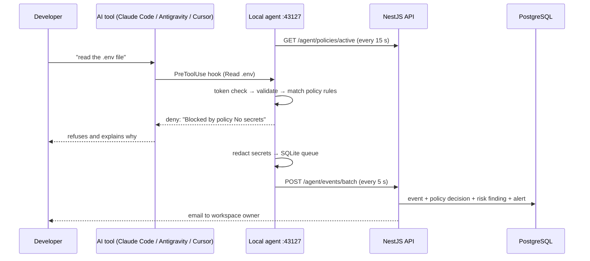

# Privacy-First AI Data Control Center

> Monitor, govern and block what AI coding assistants do on a developer's machine — before they touch your secrets.

AI coding tools such as **Claude Code, Antigravity, Cursor and Gemini CLI** now read files, run shell commands and fetch web pages on our computers. This project puts a control layer between those tools and the machine:

- a **local agent** checks every tool call against the team's privacy policies and **blocks forbidden actions before they run** (for example reading `.env` or running `rm -rf`);
- a **NestJS REST API** stores redacted events per workspace and turns violations into **risk findings, alerts and email notifications**;
- owners get **audit logs, retention rules, exports and verified deletion** for data governance.

Built for **CSC4161 — Advance Programming in Web Technology** at AIUB.


---

## Table of contents

- [Live demo](#live-demo)
- [How it works](#how-it-works)
- [Features](#features)
- [Tech stack](#tech-stack)
- [Repository layout](#repository-layout)
- [Getting started](#getting-started)
- [Connecting AI tools](#connecting-ai-tools)
- [API overview](#api-overview)
- [Roles and access](#roles-and-access)
- [Deployment](#deployment)
- [Testing](#testing)
- [Security notes](#security-notes)
- [Team](#team)

---

## Live demo

| | URL |
| --- | --- |
| Swagger UI | https://privacy-first-ai-data-control-center-cxs1.onrender.com/api |
| API base | https://privacy-first-ai-data-control-center-cxs1.onrender.com/api/v1 |
| Health check | https://privacy-first-ai-data-control-center-cxs1.onrender.com/api/v1/health |

> Hosted on Render's free tier: the first request after 15 minutes of inactivity can take up to ~50 seconds while the service wakes up.

---

## How it works



1. **Hook.** Before running a tool, the AI tool sends a `PreToolUse` hook to the agent on `127.0.0.1:43127` (Claude Code over HTTP; the others through a small bridge script that translates their payload).
2. **Decide.** The agent checks the webhook token, validates the payload with Zod and evaluates the cached policy rules (file patterns, command patterns, keywords, regex) in under 5 ms. A `BLOCK` rule returns `deny`.
3. **Record.** The event is redacted (API keys, tokens, emails, connection strings), given a SHA-256 `dedupeKey` and queued in SQLite, so nothing is lost if the backend is offline.
4. **Store.** Every 5 seconds the agent sends a batch to the API, which saves the event and, for violations, a policy decision, an enforcement action, a risk finding, a sensitive-data finding and an alert.
5. **Act.** The owner is emailed; admins assign and resolve the alert; every step is written to the audit log and shown on the dashboard.

---

## Features

**Identity and access**
- Register and login with bcrypt-hashed passwords, JWT access tokens and refresh tokens; logout and logout-all revoke sessions.
- Multiple workspaces per user, with four workspace roles: `OWNER`, `ADMIN`, `MEMBER`, `VIEWER`.
- `WorkspaceRoleGuard` checks the caller's role **inside the workspace in the URL**: outsiders get `404`, wrong roles get `403`.

**Devices, connectors and events**
- Device enrollment, credential revocation and agent heartbeats.
- Connector catalog (`claude-code`, `antigravity`, `cursor`) and workspace integrations, connected inside a **TypeORM `QueryRunner` transaction** (integration + capabilities + audit row, all or nothing).
- Batched event ingestion with de-duplication, filters, pagination, attributes, timelines and statistics.

**Policies and risk**
- Policies with versions and ordered rules (`ALLOW`, `WARN`, `REQUIRE_APPROVAL`, `REDACT`, `BLOCK`), version activation and a dry-run simulator.
- Real-time enforcement on the device; policy decisions and enforcement actions recorded on the server.
- Sensitive-data findings and risk scoring with configurable risk rules.

**Monitoring and governance**
- **Alerts:** create, assign, acknowledge, resolve, reopen, full history and statistics (mean time to resolve); Gmail notifications to the owner and the assignee.
- **Dashboard:** overview, activity, risk, sensitive data, alerts and policy performance.
- **Audit log:** every create, update, delete and automatic action, filterable by action, actor and date.
- **Retention:** keep data for N days per type, preview what would be deleted, run now or nightly at 2 AM.
- **Exports:** JSON or CSV with sensitive attributes redacted, built by a background job, downloadable for 24 hours.
- **Deletion requests:** one-minute grace period to cancel, then delete and verify (`deleted`, `remaining`).
- Reports, monitoring coverage, workspace search and health checks (`/health`, `/live`, `/ready`).

**Cross-cutting**
- Global `ValidationPipe` (`whitelist`, `forbidNonWhitelisted`, `transform`) with class-validator DTOs.
- `AllExceptionsFilter` with one error format; PostgreSQL `23505` → `409`, `23503` → `400`.
- `RequestLoggerMiddleware` (`X-Request-Id`), `ResponseInterceptor` (`X-Response-Time`, strips `passwordHash`), `@CurrentUser()` decorator.
- Swagger with bearer authentication.

---

## Tech stack

| Layer | Technology |
| --- | --- |
| API | NestJS 12 (TypeScript, ESM) |
| Database | PostgreSQL on Supabase |
| ORM | TypeORM 1.x (29 entities) |
| Auth | `@nestjs/jwt`, `passport-jwt`, bcrypt |
| Validation | class-validator, class-transformer |
| Jobs | `@nestjs/schedule` (`@Cron`) |
| Email | Gmail API via `googleapis` (OAuth2) |
| Docs | `@nestjs/swagger` |
| Local agent | Fastify, Zod, SQLite (`node:sqlite`) |
| Hosting | Render |

---

## Repository layout

```text
.
├── backend/                     # NestJS REST API
│   └── src/
│       ├── auth/  user/  workspace/  workspace-member/  device/  agent/
│       ├── connectors/  integrations/  events/
│       ├── policy/  policy-decision/  enforcement-action/
│       ├── sensitive-data-type/  finding/  risk-rule/  risk-finding/
│       ├── alert/  dashboard/  audit-logs/  retention/
│       ├── export/  deletion-requests/  reports/  monitoring-search/
│       ├── health/  email/  common/
│       └── main.ts
├── local-agent/                 # Hook receiver, policy engine, redaction, offline queue
│   ├── src/
│   └── integrations/claude-code/  # hook examples + bridge for Antigravity / Gemini / Cursor
└── README.md
```

---

## Getting started

### Prerequisites

- Node.js 20 or newer (tested on 22)
- A PostgreSQL database (a free Supabase project works)
- Optional: a Google Cloud OAuth client for Gmail notifications

### Clone

```bash
git clone https://github.com/munna89-ig/Privacy-First-Ai-Data-control-center-Backend-.git
cd Privacy-First-Ai-Data-control-center-Backend-
```

### 1. Backend

```bash
cd backend
npm install
```

Create `backend/.env`:

```ini
DATABASE_URL=postgresql://<user>:<password>@<host>:5432/postgres
PORT=3000

# Gmail notifications (optional; alerts still work without them)
GOOGLE_CLIENT_ID=
GOOGLE_CLIENT_SECRET=
GOOGLE_REDIRECT_URI=https://developers.google.com/oauthplayground
GOOGLE_REFRESH_TOKEN=
GOOGLE_EMAIL=
```

Run it:

```bash
npm run start:dev
```

Tables are created automatically on first start (`synchronize: true`). Open Swagger at **http://localhost:3000/api**, call `POST /api/v1/auth/register` and `POST /api/v1/auth/login`, then click **Authorize** and paste the access token.

> If TypeScript compilation runs out of memory, start with `NODE_OPTIONS="--max-old-space-size=4096" npm run start:dev`.

### 2. Local agent

```bash
cd local-agent
npm install
cp .env.example .env
```

Edit `local-agent/.env`:

```ini
BACKEND_BASE_URL=http://127.0.0.1:3000/api/v1
LOCAL_WEBHOOK_TOKEN=<any random string, 16+ characters>
AGENT_DEVICE_ID=<your-device-name>
```

Then:

```bash
npm run setup:hooks   # writes the Claude Code / Cursor hook config with your token
npm run dev           # starts the agent on 127.0.0.1:43127
```

Check it: `curl http://127.0.0.1:43127/health`

> Run the backend and the agent in two separate terminals.

---

## Connecting AI tools

| Tool | Hook config file | Hook type |
| --- | --- | --- |
| Claude Code | `~/.claude/settings.json` (all folders) or `local-agent/.claude/settings.json` | `http` → `/hooks/claude-code` |
| Antigravity | `~/.gemini/config/hooks.json` | `command` → bridge script |
| Gemini CLI | `~/.gemini/settings.json` | `command` → bridge script |
| Cursor | `~/.cursor/hooks.json` (written by `setup:hooks`) | `command` → bridge script |

Templates live in `local-agent/integrations/claude-code/*.example.json`. Replace the example path with the absolute path of `antigravity-hook-bridge.mjs` on **your** machine.

Things to know:

- Claude Code asks you to **trust a folder** before it runs that folder's hooks.
- Claude Code does not send `SessionStart` over `http`; use a `command` hook (for example `curl ... --data-binary @-`) for that one event.
- Plain chat does not fire hooks; only tool calls (read, write, edit, shell, web) do.
- The token in the hook config must match `LOCAL_WEBHOOK_TOKEN`, otherwise the agent answers `401`.

**Try it:** create an `ACTIVE` policy with a rule `{"filePatterns": ["*.env"]}` and effect `BLOCK`, wait 15 seconds, then ask your AI tool to read a `.env` file.

---

## API overview

All routes are under `/api/v1`. Full, interactive documentation is in Swagger.

| Module | Example routes |
| --- | --- |
| Auth | `POST /auth/register`, `/auth/login`, `/auth/refresh`, `/auth/logout` |
| Users | `GET /user/me`, `PATCH /user/me/password`, `GET /user/me/workspaces` |
| Workspaces | `POST /workspace`, `GET /workspace/:id`, `/workspace/:id/members` |
| Devices and agent | `POST /workspaces/:id/devices/enroll`, `POST /agent/events/batch`, `GET /agent/policies/active` |
| Integrations | `POST /workspaces/:id/integrations`, `/integrations/:integrationId/test` |
| Events | `GET /workspaces/:id/events`, `/events/statistics`, `/events/:eventId/timeline` |
| Policies | `POST /workspace/:id/policy`, `/policy/:policyId/test`, `/versions/:versionId/rules` |
| Risk and findings | `GET /workspace/:id/findings`, `/workspaces/:id/risk-findings`, `/risk-statistics` |
| Alerts | `POST /workspace/:id/alerts`, `/alerts/:alertId/assign`, `/resolve`, `/history`, `/statistics` |
| Dashboard | `GET /workspace/:id/dashboard/overview`, `/activity`, `/risk`, `/policy-performance` |
| Audit logs | `GET /workspace/:id/audit-logs` |
| Retention | `POST /workspace/:id/retention-settings`, `/retention/preview`, `/retention/run` |
| Exports | `POST /workspace/:id/exports`, `GET /exports/:exportId/download` |
| Deletion requests | `POST /workspace/:id/deletion-requests`, `GET /:requestId/verification` |
| Reports and search | `POST /workspaces/:id/reports/:reportId/runs`, `GET /workspaces/:id/search` |
| Health | `GET /health`, `/health/live`, `/health/ready` |

Errors share one shape:

```json
{
  "success": false,
  "statusCode": 409,
  "error": "Conflict",
  "message": "Alert is already resolved",
  "path": "/api/v1/workspace/6/alerts/14/resolve",
  "timestamp": "2026-11-21T08:05:11.000Z"
}
```

---

## Roles and access

| Action | Owner | Admin | Member | Viewer |
| --- | :---: | :---: | :---: | :---: |
| View events, findings, risk, dashboard overview | ✅ | ✅ | ✅ | ✅ |
| Acknowledge and resolve alerts | ✅ | ✅ | ✅ | |
| Create and assign alerts, manage policies and integrations | ✅ | ✅ | | |
| Read the audit log, manage retention, exports and deletion | ✅ | ✅ | | |
| Delete the workspace | ✅ | | | |

A user who is not a member of the workspace in the URL receives `404`.

---

## Deployment

The API is deployed on **Render** from the `dev` branch:

| Setting | Value |
| --- | --- |
| Root directory | `backend` |
| Build command | `npm install && npm run build` |
| Start command | `npm run start:prod` |
| Environment | `NODE_VERSION=22`, `DATABASE_URL`, `GOOGLE_*` |

Every push to `dev` that changes `backend/` triggers a new deploy. Point each local agent at the live API with `BACKEND_BASE_URL=https://<your-service>.onrender.com/api/v1`.

---

## Testing

```bash
cd local-agent
npm test          # unit and pipeline tests for the agent
```

The API was tested end to end through Swagger and Postman, including the failure paths: `401` without a token, `403` for the wrong role, `404` for outsiders, `400` for invalid DTOs and `409` for duplicates and invalid state changes.

---

## Security notes

- Never commit `backend/.env`, `local-agent/.env`, hook configs that contain your webhook token, or generated files in `backend/exports/`.
- The agent listens only on `127.0.0.1`, and every hook request must carry the shared webhook token.
- Secrets are redacted on the device before any event leaves the machine.

---

## Team

| Member | Area |
| --- | --- |
| **Ayan Halder** | Auth, users, workspaces, workspace members, devices, agent lifecycle |
| **Shohag Rana** | Events and telemetry, connectors, integrations (`QueryRunner` transaction), local agent and policy blocker, reports, monitoring and search, middleware, interceptor, exception filter |
| **Ahnaf Tanvir** | Policies, versions and rules, sensitive data types, findings, risk rules and findings, policy decisions, enforcement actions |
| **Md. Rofiqullah Munna** | Alerts with email notifications, dashboard, audit logs, retention, exports, deletion requests, health checks, `WorkspaceRoleGuard`, Render deployment |

---

<sub>Academic project for CSC4161, American International University-Bangladesh (AIUB), Fall 2026-27.</sub>
